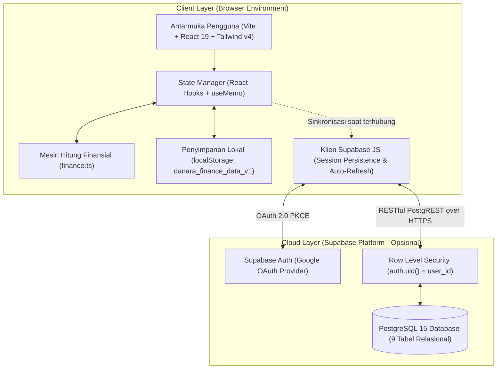
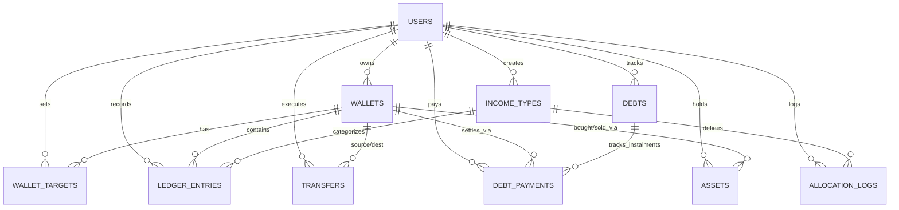

# SYSTEM ARCHITECTURE

Dokumen Penanggung Jawab: PEREKAYASA (Direktorat II: Teknologi & Rekayasa)
Target Pembaca AI: Claude Code, Cursor, Codex, dan seluruh instans agen koding.
Status Dokumen: Disetujui (Baseline Hasil Rekayasa Balik Sistem Eksisting)
Versi: 1.1.0

---

## 01 System Overview
Danara dirancang dengan topologi **Local-First Client-Side Application** yang memiliki kapabilitas sinkronisasi opsional ke **Cloud Backend Terkelola (Supabase)**. Klien dapat beroperasi secara otonom tanpa jaringan internet dan tanpa keharusan membuat akun atau melewati sesi login.



## 02 Tech Stack
Agen AI dilarang memasang atau mengimpor pustaka di luar tabel terotorisasi ini:

| Ranah Sistem | Teknologi Terpilih | Versi | Peran & Justifikasi Arsitektur |
|---|---|---|---|
| Runtime & Build | Node.js & Vite | Node 20+, Vite 6 | Build tool ultra-cepat berbasis ESM murni |
| Bahasa Utama | TypeScript | 5.8+ | Penegakan strict types tanpa toleransi tipe any |
| UI Framework | React | 19.x | Arsitektur komponen fungsional modern dan reaktif |
| Styling Engine | Tailwind CSS | 4.3+ | Utility-first CSS generasi 4 via @tailwindcss/vite |
| Tipografi | Plus Jakarta Sans | 5.3+ | Fontsans modern dengan tabular numbers untuk angka keuangan |
| Ikonografi | Lucide React | Latest | Line-icons konsisten ukuran 14px hingga 24px |
| Penyimpanan Klien | Web Storage API | Native | Persistensi instan data keuangan di perangkat lokal |
| Backend & Cloud | Supabase Platform | 2.116+ | PostgreSQL terkelola, Auth OAuth, RLS, Edge Functions |
| Pengujian Unit | Vitest & JSDOM | Latest | Pengujian unit deterministik secepat kilat untuk logika murni |

## 03 Project Structure
Tata letak direktori baku repositori Danara:

```text
DANARA/
├── .github/
│   └── workflows/
│       └── deploy.yml            # CI/CD otomatis ke GitHub Pages
├── diagrams/
│   ├── database-schema.html      # Visualisasi mandiri skema basis data editorial
│   ├── system-architecture.html  # Visualisasi arsitektur 4-tier editorial
│   └── README.md
├── docs/
│   ├── PRD.md                    # Dokumen persyaratan produk (ANALIS)
│   ├── ARCHITECTURE.md           # Dokumen arsitektur sistem (PEREKAYASA)
│   ├── DESIGN-SYSTEM.md          # Standar token visual & antarmuka (PERANCANG)
│   ├── CODE-STYLE.md             # Konvensi TypeScript & linter (PEREKAYASA)
│   ├── SECURITY.md               # Model ancaman & sanitasi data (PENGUJI)
│   └── TESTING.md                # Strategi pengujian & QA (PENGUJI & AUDITOR)
├── public/
│   └── money.ico                 # Favicon resmi peramban
├── src/
│   ├── components/
│   │   ├── dashboard/
│   │   │   ├── LedgerTable.tsx   # Tabel transaksi dengan filter jenis mutasi
│   │   │   ├── MetricCard.tsx    # Kartu ringkasan KPI eksekutif
│   │   │   └── WalletCard.tsx    # Kartu dompet dengan progress bar target
│   │   ├── forms/
│   │   │   ├── DangerResetModal.tsx   # Modal validasi berjenjang 3 lapis
│   │   │   ├── TransactionModals.tsx  # Form modal income, expense, transfer
│   │   │   └── WalletForms.tsx        # Form pembuatan dan penyuntingan dompet
│   │   ├── layout/
│   │   │   ├── AppLayout.tsx     # Shell induk: header, drawer, sidebar, FAB, bottom nav
│   │   │   └── types.ts          # Definisi tipe navigasi dan user context
│   │   ├── ui/
│   │   │   ├── primitives.tsx    # Komponen atomik: ModalShell, Badge, Empty
│   │   │   └── Toast.tsx         # Notifikasi mengambang (floating feedback)
│   │   └── views/
│   │       ├── AssetsView.tsx    # Manajemen aset, harga beli/kini, untung/rugi
│   │       ├── CalendarView.tsx  # Kalender agregasi mutasi transaksi harian
│   │       ├── DashboardView.tsx # Dasbor 6 KPI eksekutif dan distribusi saldo
│   │       ├── DebtsView.tsx     # Pengelolaan hutang/piutang dan pelunasan
│   │       ├── HistoryView.tsx   # Riwayat transaksi lengkap buku besar
│   │       ├── MenuView.tsx      # Hub navigasi modul sekunder mobile
│   │       ├── SettingsView.tsx  # Konfigurasi akun, alokasi tipe, dan Danger Zone
│   │       └── WalletsView.tsx   # Manajemen dompet kas dan target tabungan
│   ├── lib/
│   │   ├── finance.ts            # Fungsi kalkulasi finansial murni (Pure logic)
│   │   ├── finance.test.ts       # Pengujian unit kalkulasi finansial
│   │   ├── storage.ts            # Adapter persistensi localStorage lokal
│   │   ├── storage.test.ts       # Pengujian persistensi lokal
│   │   ├── supabase.ts           # Adapter komunikasi API Supabase & RLS
│   │   └── types.ts              # Definisi entitas dan tipe data global
│   ├── styles/
│   │   └── tokens.css            # Token desain, variabel warna, font scale
│   ├── App.tsx                   # Controller utama state dan alur transaksi
│   ├── index.css                 # Titik masuk CSS global
│   ├── main.tsx                  # Titik masuk React DOM rendering
│   └── vite-env.d.ts             # Tipe lingkungan Vite
├── supabase/
│   ├── migrations/
│   │   ├── 20260912000000_schema.sql         # Skema tabel inti relasional
│   │   ├── 20260912010000_rls.sql            # Kebijakan Row Level Security
│   │   ├── 20260912120000_debts_budgets.sql  # Modul hutang dan anggaran
│   │   └── 20260913000000_phase4.sql         # Modul target dompet & aset
│   └── config.toml               # Konfigurasi proyek Supabase lokal
├── AGENTS.md                     # Protokol operasional agen koding AI
├── package.json                  # Manajer dependensi dan skrip eksekusi
├── README.md                     # Panduan orientasi pengembang manusia
├── tsconfig.json                 # Konfigurasi TypeScript aplikasi
└── vite.config.ts                # Konfigurasi bundler Vite
```

## 04 Data Flow & Business Logic

### 1. Alur Alokasi Pendapatan Proporsional (Income Allocation)
1. Pengguna memasukkan nominal dana masuk kotor (contoh: Rp 10.000.000) dan memilih template `IncomeType` (contoh: Gaji Bulanan).
2. Sistem memvalidasi apakah konfigurasi persentase dompet pada template tersebut berjumlah tepat 100% via `isValidAllocation()`.
3. Mesin `splitIncome()` memecah nominal ke masing-masing dompet berdasarkan bobot persentase. Pembulatan pecahan dialokasikan ke dompet urutan terakhir untuk mencegah hilangnya selisih nominal (zero rounding leakage).
4. Dihasilkan sebuah `groupId` berbasis UUID. Setiap dompet tujuan menerima satu entri bertipe `income` di dalam `ledger_entries`.
5. Satu entri log audit dicatat di tabel `allocation_logs`.
6. Data disimpan secara instan ke `localStorage` dan di-upsert ke Supabase jika terhubung ke cloud.

### 2. Alur Pengeluaran Kas (Expense)
1. Pengguna memilih dompet sumber dan mengisi nominal pengeluaran.
2. Sistem mengecek ketersediaan saldo via `calculateBalances()`. Jika nominal melebihi saldo dompet yang tersedia, transaksi ditolak sebelum mutasi state terjadi.
3. Satu entri bertipe `expense` dicatat pada `ledger_entries` dengan nilai bersih negatif saat diagregasikan.

### 3. Alur Pindah Saldo (Double-Entry Fund Transfer)
1. Pengguna memilih dompet asal (`from_wallet_id`), dompet tujuan (`to_wallet_id`), dan nominal.
2. Sistem memvalidasi bahwa dompet asal dan tujuan tidak boleh sama, serta saldo dompet asal mencukupi.
3. Mesin `newTransfer()` membangkitkan sepasang entri buku besar berpasangan:
   - Satu entri `transfer-out` pada dompet asal (bernilai negatif terhadap saldo dompet asal).
   - Satu entri `transfer-in` pada dompet tujuan (bernilai positif terhadap saldo dompet tujuan).
   - Keduanya berbagi `groupId` identik.
4. Total saldo bersih global aplikasi tidak mengalami perubahan (zero balance drift).

### 4. Alur Pelunasan Hutang Terhubung Dompet (Debt Settlement)
1. Pengguna membuka kartu hutang/piutang dan memilih aksi bayar atau terima dana.
2. Pengguna menentukan nominal angsuran serta memilih apakah pembayaran menggunakan dompet kas internal atau dompet luar.
3. Jika dompet kas dipilih:
   - Pembayaran hutang (arah `owe`) otomatis menghasilkan entri `expense` pada dompet kas.
   - Penerimaan piutang (arah `owed`) otomatis menghasilkan entri `income` pada dompet kas.
4. Entri riwayat angsuran dicatat pada `debt_payments`.
5. Status hutang dievaluasi: jika sisa kewajiban bernilai 0, status diperbarui menjadi `paid`.

### 5. Alur Penjualan Aset Terhubung Dompet (Asset Liquidation)
1. Pengguna mengeksekusi penjualan pada aset aktif dengan mengisi harga jual realisasi dan tanggal penjualan.
2. Jika dompet kas penerima hasil penjualan dipilih (`sell_wallet_id`), sistem otomatis membuat satu entri `income` pada buku besar dengan keterangan penjualan aset.
3. Status aset beralih dari `active` menjadi `sold`. Nilai aset tidak lagi dihitung dalam total nilai portofolio aktif pada KPI dasbor.

### 6. Alur Zona Bahaya Reset Data (Tiered Danger Reset)
1. Pengguna membuka Pengaturan -> Zona Bahaya.
2. Modal konfirmasi 3 tahap ditampilkan:
   - Tahap 1: Membaca daftar item yang akan dihapus.
   - Tahap 2: Menandai checkbox persetujuan resiko permanen.
   - Tahap 3: Mengetik kata kunci wajib `HAPUS SEMUA`.
3. Setelah tombol diaktifkan dan diklik, `localStorage` dibersihkan dan dikembalikan ke `initialFinanceData`.
4. Jika pengguna terhubung ke cloud Supabase, helper `clearRemoteFinanceData()` mengeksekusi penghapusan kaskade berurutan pada 9 tabel PostgreSQL, lalu meng-upsert data awal default.

## 05 Relational Database Schema (PostgreSQL)



### Rincian Tabel dan Kolom:

1. **wallets** (Identitas Dompet Kas / Bank):
   - `id` (uuid, PK, default gen_random_uuid())
   - `user_id` (uuid, FK auth.users, NOT NULL)
   - `name` (text, NOT NULL)
   - `account` (text, NOT NULL, default '')
   - `color` (text, NOT NULL, default '#2563eb')
   - `created_at` (timestamp, default now())

2. **wallet_targets** (Target Tabungan per Dompet):
   - `id` (uuid, PK, default gen_random_uuid())
   - `user_id` (uuid, FK auth.users, NOT NULL)
   - `wallet_id` (uuid, FK wallets ON DELETE CASCADE, NOT NULL)
   - `target_amount` (bigint, check > 0, NOT NULL)
   - *Constraint:* UNIQUE(user_id, wallet_id)

3. **income_types** (Template Alokasi Pendapatan):
   - `id` (uuid, PK, default gen_random_uuid())
   - `user_id` (uuid, FK auth.users, NOT NULL)
   - `name` (text, NOT NULL)
   - `allocations` (jsonb, NOT NULL, default '{}'::jsonb)
   - `created_at` (timestamp, default now())

4. **ledger_entries** (Buku Besar Mutasi Transaksi):
   - `id` (uuid, PK, default gen_random_uuid())
   - `user_id` (uuid, FK auth.users, NOT NULL)
   - `date` (date, NOT NULL)
   - `note` (text, NOT NULL, default '')
   - `wallet_id` (uuid, FK wallets, NOT NULL)
   - `kind` (text, check in ('income', 'expense', 'transfer-out', 'transfer-in'), NOT NULL)
   - `amount` (bigint, NOT NULL)
   - `group_id` (uuid, NULLABLE)
   - `income_type_id` (uuid, FK income_types, NULLABLE)

5. **allocation_logs** (Audit Log Pembagian Dana Pemasukan):
   - `id` (uuid, PK, default gen_random_uuid())
   - `user_id` (uuid, FK auth.users, NOT NULL)
   - `date` (date, NOT NULL)
   - `income_type_id` (uuid, FK income_types, NOT NULL)
   - `amount` (bigint, NOT NULL)
   - `group_id` (uuid, NOT NULL)

6. **transfers** (Audit Log Perpindahan Saldo Antar-Dompet):
   - `id` (uuid, PK, default gen_random_uuid())
   - `user_id` (uuid, FK auth.users, NOT NULL)
   - `date` (date, NOT NULL)
   - `note` (text, NOT NULL, default '')
   - `from_wallet_id` (uuid, FK wallets, NOT NULL)
   - `to_wallet_id` (uuid, FK wallets, NOT NULL)
   - `amount` (bigint, NOT NULL)

7. **debts** (Pencatatan Hutang dan Piutang):
   - `id` (uuid, PK, default gen_random_uuid())
   - `user_id` (uuid, FK auth.users, NOT NULL)
   - `name` (text, NOT NULL)
   - `direction` (text, check in ('owe', 'owed'), NOT NULL)
   - `initial_amount` (bigint, check > 0, NOT NULL)
   - `note` (text, NOT NULL, default '')
   - `status` (text, check in ('active', 'paid'), default 'active', NOT NULL)
   - `created_at` (timestamp, default now())

8. **debt_payments** (Angsuran dan Pelunasan Hutang):
   - `id` (uuid, PK, default gen_random_uuid())
   - `user_id` (uuid, FK auth.users, NOT NULL)
   - `debt_id` (uuid, FK debts ON DELETE CASCADE, NOT NULL)
   - `date` (date, NOT NULL)
   - `amount` (bigint, check > 0, NOT NULL)
   - `wallet_id` (uuid, FK wallets, NULLABLE)
   - `note` (text, NOT NULL, default '')

9. **assets** (Portofolio Aset Fisik & Investasi):
   - `id` (uuid, PK, default gen_random_uuid())
   - `user_id` (uuid, FK auth.users, NOT NULL)
   - `name` (text, NOT NULL)
   - `category` (text, NOT NULL)
   - `buy_price` (bigint, check > 0, NOT NULL)
   - `current_price` (bigint, check >= 0, NOT NULL)
   - `sell_price` (bigint, check sell_price is null or sell_price >= 0, NULLABLE)
   - `buy_date` (date, NOT NULL)
   - `sell_date` (date, NULLABLE)
   - `status` (text, check in ('active', 'sold'), default 'active', NOT NULL)
   - `buy_wallet_id` (uuid, FK wallets ON DELETE SET NULL, NULLABLE)
   - `sell_wallet_id` (uuid, FK wallets ON DELETE SET NULL, NULLABLE)
   - `note` (text, NOT NULL, default '')
   - `created_at` (timestamp, default now())

## 06 Scalability & Modular Rules
1. **Pemisahan Logika Murni (Pure Financial Logic)**: Semua perhitungan agregasi, saldo, pemotongan persen, dan kalkulasi P/L diisolasi pada `src/lib/finance.ts` dan wajib 100% lulus uji unit tanpa ketergantungan pada DOM atau browser state.
2. **Kedaulatan Klien (Local-First Priority)**: State antarmuka selalu membaca dan menulis ke penyimpanan lokal terlebih dahulu untuk menjamin zero latency. Sinkronisasi cloud berjalan asinkron di latar belakang tanpa menghalangi kelancaran pengguna.
3. **Pemberian Identitas UUID Sisi Klien**: Seluruh entitas baru (wallet, entry, debt, asset) diberi ID acak berbasis `crypto.randomUUID()` di sisi klien sebelum disimpan ke basis data, mencegah konflik kunci primer saat sinkronisasi data lokal ke remote.
